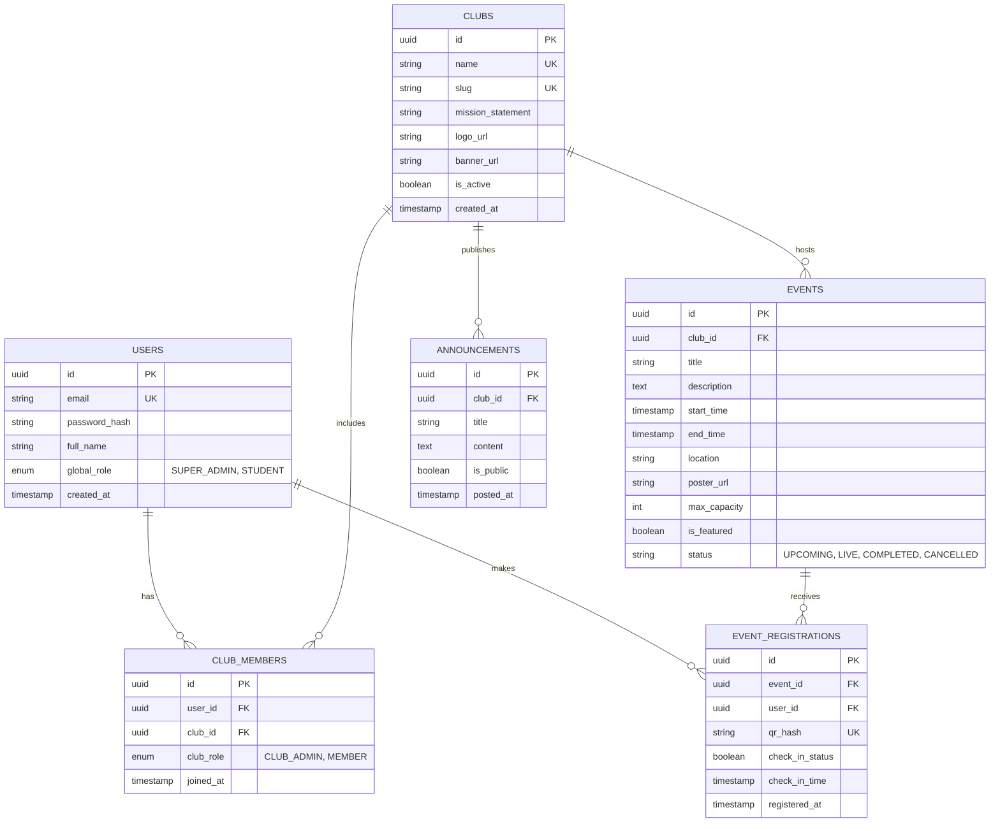

# AXIS Project Architecture & Implementation Plan

## 1. User Roles & Permission System (PostgreSQL Schema)

The database schema forms the foundation of AXIS, enabling seamless interactions across all three main roles:
1. **Super Admin**: Complete platform visibility, global configurations, club approvals.
2. **Club Admin**: Local management over specific clubs, event creation, attendance tracking.
3. **Student**: Event discovery, registration, club following, dashboard personalization.

### ER Diagram Logic (Core Entities)



## 2. API Folder Structure (Node.js/Express)

To support maintainability and scalability, we employ a layered architecture (Routes -> Controllers -> Services -> Repositories/Models).

```text
AXIS-backend/
├── src/
│   ├── app.js                 # Express app initialization & root middleware
│   ├── server.js              # Server entry point
│   ├── config/                # Environment, DB credentials, JWT settings
│   │   ├── db.config.js
│   │   └── auth.config.js
│   ├── models/                # PostgreSQL Models (Sequelize/Knex)
│   │   ├── index.js           # DB connection & relationships setup
│   │   ├── User.js
│   │   ├── Club.js
│   │   ├── Event.js
│   │   ├── EventRegistration.js
│   │   └── ...
│   ├── routes/                # API Endpoints (v1)
│   │   ├── index.js           # API router aggregator
│   │   ├── authRoutes.js
│   │   ├── clubRoutes.js
│   │   ├── eventRoutes.js
│   │   └── adminRoutes.js
│   ├── controllers/           # Request/Response handlers
│   │   ├── authController.js
│   │   ├── clubController.js
│   │   ├── eventController.js
│   │   └── adminController.js
│   ├── services/              # Business Logic & External Integrations
│   │   ├── qrService.js       # QR Code generation & verification logic
│   │   ├── authService.js     # Login, tokens, password logic
│   │   ├── emailService.js    # SendGrid/Nodemailer integrations
│   │   └── analyticsService.js# Aggregates data for the Admin Portal
│   ├── middlewares/           # RBAC and Validation
│   │   ├── authMiddleware.js  # JWT validation
│   │   ├── rbacMiddleware.js  # Role-checking (e.g., must be CLUB_ADMIN)
│   │   └── errorHandler.js    # Centralized error response formatting
│   └── utils/                 # Helpers (Constants, Regex, Formatters)
│       └── responseHelper.js
├── package.json
└── .env
```

## 3. Technology & Integration Details

- **Backend Framework**: Node.js with Express.
- **ORM/Query Builder**: Sequelize is recommended for rapid development of complex relational queries like fetching "Club Stats" or "User Dashboard".
- **Authentication**: JWT containing `user_id`, `global_role`, and an array of `club_admin_ids` to instantly verify permissions via middleware without hitting the DB on every request.
- **Frontend State Management**: Redux Toolkit (RTK) with RTK Query. It provides robust caching, which is critical for real-time trackers (e.g., Live Events) and the Admin Analytics dashboard.

## 4. Addressing Core Features

- **Real-time Event Tracker**: The frontend dashboard polls (or uses websockets/SSE) a dedicated `/api/v1/events/tracker` endpoint that filters events by the user's registrations and segregates them into Live/Upcoming categories.
- **QR-Based Attendance**: Upon registration, `qrService` hashes the `registration_id` + a fast-rotating secret. The frontend displays this QR. Club Admins have a scanner view that sends the hash to a `/check-in` internal API, securely flipping the `check_in_status`.
- **Publicity Engine & Analytics**: Managed by `bento-grid` layouts dynamically fetching data. Exporting functionality relies on a backend service compiling CSVs via `json2csv` libraries on-the-fly when requested by Club Leads.
